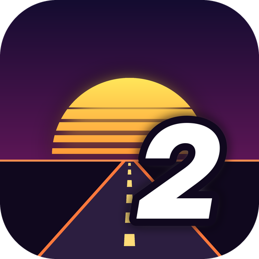
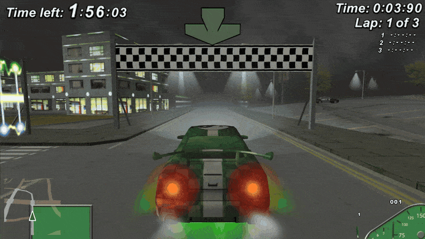
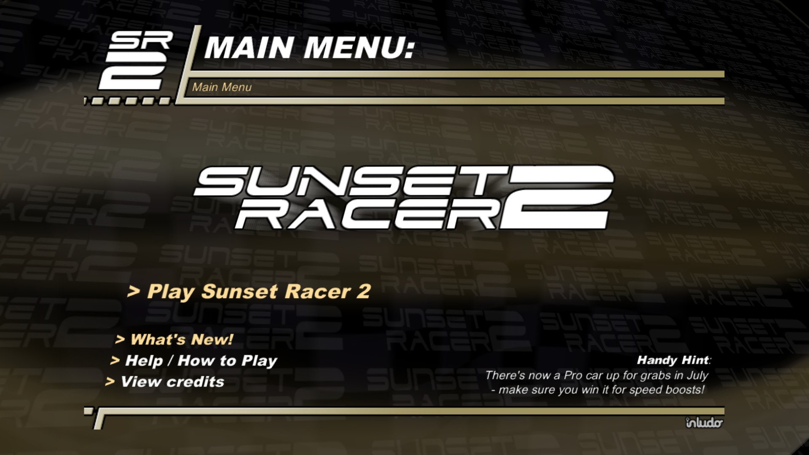
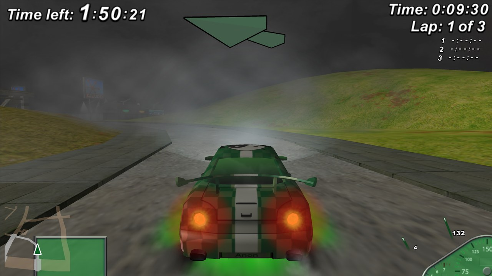

  

<h1 align="center">Sunset Racer 2</h1>

<em>Sunset Racer 2 Story Mode with widescreen 1080p, smooth motion and a portable Windows build.</em>

  
  &nbsp;
  

  

This is a standalone Windows rebuild of Inludo’s Sunset Racer 2 Story Mode (build 376). It keeps the original racing and adds widescreen rendering, smoother motion and optional visual effects.

<a href="#features">Features</a> · <a href="#screenshots">Screenshots</a> · <a href="#install">Install</a> · <a href="#performance">Performance</a> · <a href="#credits">Credits</a>

## Features

- **Widescreen and 1080p.** Use borderless fullscreen at your monitor’s resolution or resize the window. Menus and the HUD scale separately. Press <kbd>Alt</kbd>+<kbd>Enter</kbd> to switch display modes.
- **Smooth racing.** The original 30 Hz race simulation is interpolated between updates. Set a frame rate cap or run uncapped in *Options → Display settings*.
- **DirectX 9 and Vulkan.** Choose a renderer in *Options → Visual effects*. The change takes effect when you enter the next race.
- **Optional effects and 3D audio.** Tune anti-aliasing, ambient occlusion, motion blur, lighting, weather and Steam Audio reverb in *Options → Visual effects*.

## Screenshots

  
  

## Install

1. Download [Sunset-Racer-2-Windows.zip](https://github.com/SirBarnaby/Sunset-Racer-2-Modernized/releases/latest/download/Sunset-Racer-2-Windows.zip).
2. Extract the whole ZIP to a folder.
3. Open the extracted `Sunset Racer 2` folder and run `SunsetRacer2.exe`. Keep the EXE alongside the included files and folders.

## Performance

The Director renderer is single-threaded. In project testing, the build held 60 FPS at 1920 × 1080 with anti-aliasing enabled on an Intel Core i7-8550U and NVIDIA Quadro P500. On a 60 Hz display, select a 60 FPS cap in *Options → Display settings* for steadier motion.

## Credits

Original game by Inludo. The Windows ZIP includes the DXVK and Steam Audio notices in `licenses/`. [Inludo’s Sunset Racer 2 page](https://inludo-game-development.itch.io/sunset-racer-2)
